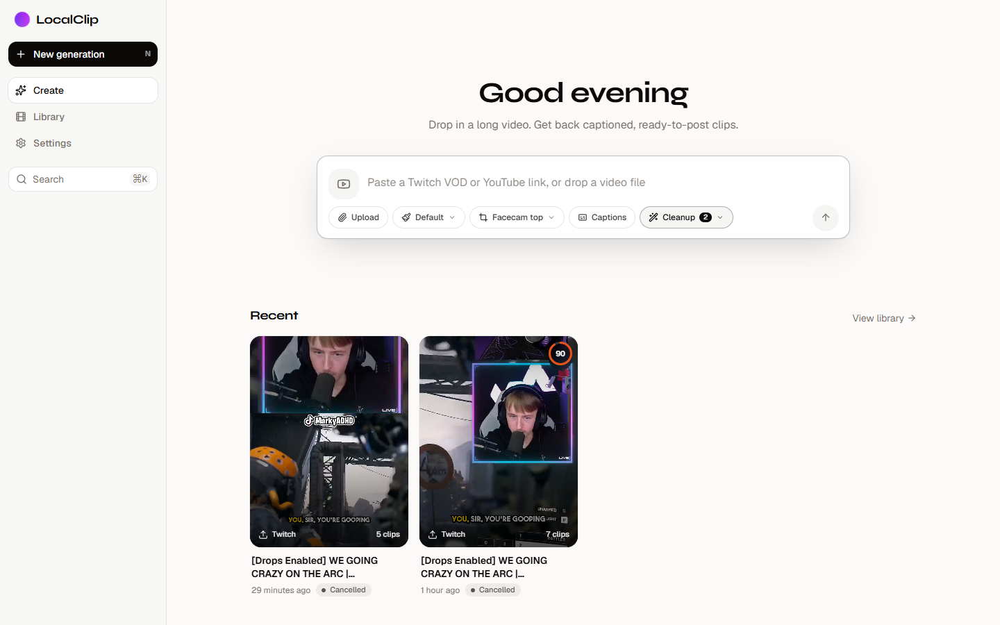
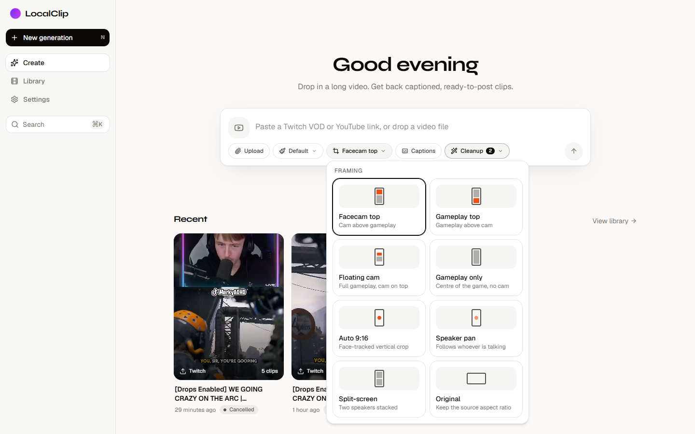
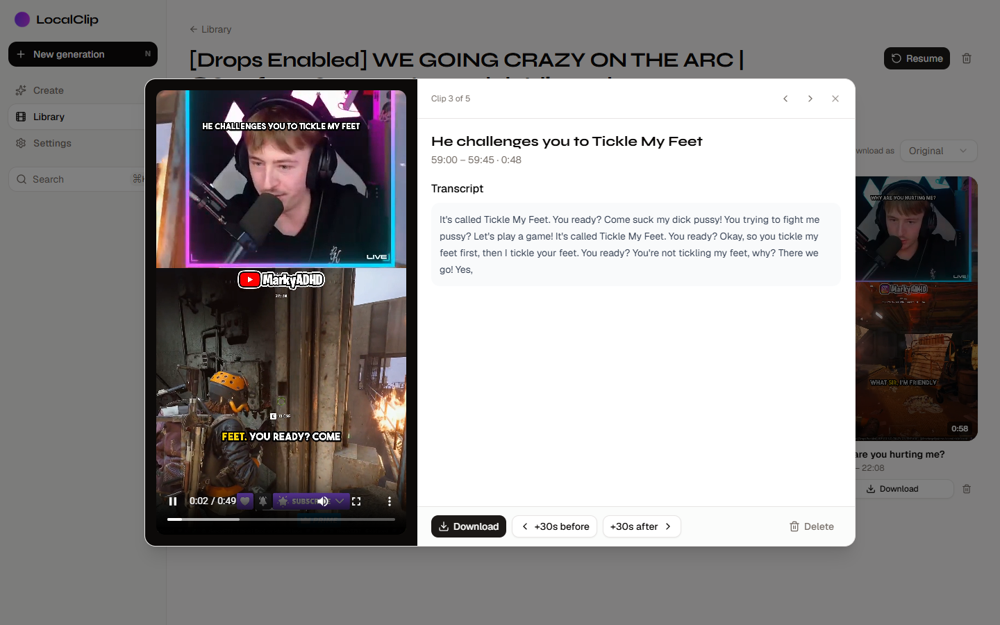
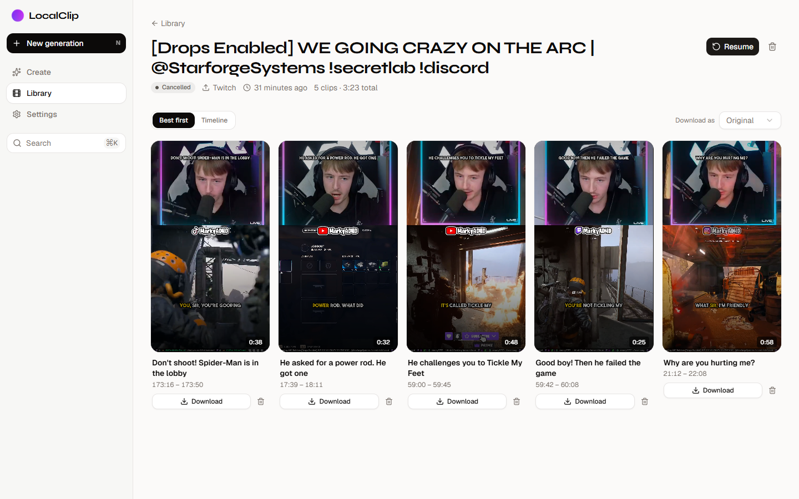

<p align="center">
  
</p>

<h1 align="center">LocalClip</h1>

<p align="center">
  <b>Bye Bye StreamLadder, Hello LocalClip.</b><br/>
  Turn your Twitch and Kick VODs into vertical TikTok / Shorts / Reels clips, on your own PC, for free.
</p>

<p align="center">
  <a href="../../releases/latest"></a>
  
  
  
</p>



Paste a Twitch or Kick VOD (or clip) or a YouTube link. LocalClip downloads it, transcribes it on your GPU, reads your Twitch chat to find where it went off, and has an AI model pick the best moments: **Claude Code**, or **any local model** on your PC (Ollama, LM Studio, llama.cpp and more). Then it renders captioned 9:16 clips with your facecam stacked over your gameplay, just like the paid clipping tools do.

You don't need a subscription, you don't upload your VODs to someone else's server, and there are no watermarks or monthly clip limits. Everything runs on your machine.

## Why not StreamLadder?

| | StreamLadder | **LocalClip** |
|---|---|---|
| Price | Monthly subscription for the good stuff | **Free and open source** |
| Where it runs | Their servers | **Your PC** (your GPU does the work) |
| Finds the clips for you | ✅ ClipGPT, in their cloud | ✅ **AI reads the whole VOD** plus your chat, on your PC |
| Facecam + gameplay layouts | ✅ | ✅ Facecam top, Gameplay top, Floating cam, Gameplay only |
| Animated captions | ✅ | ✅ Word-synced, several caption styles |
| Watermark / clip limits | On the free tier | **None** |
| Your VODs leave your PC | Yes | **No** (with Claude Code only the transcript text is sent; with a local model nothing is) |

## Features

- **Twitch and Kick VODs and clips, and YouTube links**, or upload any video file.
- **AI clip finding, tuned for streams.** The AI reads the whole transcript and picks 15–60 second stream moments (fails, clutches, reactions, chat going wild) with a strong hook, scoring each one for virality.
- **Pick your AI model.** Settings > AI model lists Claude Code (the default) plus every Ollama and LM Studio model on your PC and any OpenAI-compatible server that's running (llama.cpp, Jan, KoboldCpp, text-generation-webui, LocalAI, GPT4All, vLLM). With a local model LocalClip runs 100% offline.
- **Twitch chat signals.** LocalClip pulls the chat replay and finds the spikes where chat exploded (KEKW, LUL, Pog, "clip it"). The AI gets those as hints.
- **"Clip that" detection.** If you said "clip that" on stream, LocalClip notices and makes sure that moment is considered.
- **StreamLadder-style templates.** It auto-detects your webcam and builds the layout around it:
  - **Facecam top**: cam on top, gameplay below (the default)
  - **Gameplay top**: gameplay on top, cam below
  - **Floating cam**: the whole game frame on a blurred background, with your cam above it
  - **Gameplay only**: the centre of the game, no cam
  - Plus face-tracked crop, speaker pan, split-screen and original aspect for talking or podcast content
- **Word-synced captions** in several styles, with your own fonts and colours, plus an AI-written hook title for the first few seconds.
- **+30s before / +30s after.** Open a clip and extend it either way as many times as you like until the length is right. Each press re-renders the clip from the VOD.
- **GPU rendering.** Clips are encoded with NVENC on NVIDIA cards, two at a time, with an automatic CPU fallback.
- **Full-screen editor.** A timeline with drag-to-trim, split and cuts; facecam layouts (Fill, Fit, Cam top, Cam bottom, Floating cam); six one-click caption looks; click any word to fix or **bleep** it (or bleep every swear at once); TikTok / Reels / Shorts safe-zone guides; and an export dialog with a title and hashtags ready to copy.
- **A real Windows app.** `LocalClip.exe` opens in its own window with its own taskbar icon. Closing the window shuts everything down (handy before you game).
- **Automatic updates.** Every time you open LocalClip it checks GitHub for a new release and installs it before starting, with nothing to click.

<p align="center">
  
  
</p>



## Install (Windows 10/11)

**You need:**
- Windows 10 or 11 with [winget](https://learn.microsoft.com/windows/package-manager/winget/), which is built into Windows 11.
- An AI model to pick the clips, either of:
  - a **Claude subscription** (Pro or Max). LocalClip runs Claude Code on your plan, so no API key is needed. This is the default and gives the best picks.
  - a **local model** in [Ollama](https://ollama.com), [LM Studio](https://lmstudio.ai) or another OpenAI-compatible server. Free and fully offline; bigger models pick better clips.
- An NVIDIA GPU is strongly recommended for fast transcription. It works on CPU, just slowly. 16 GB of RAM or more is recommended.
- Plenty of disk space. VODs are big. Deleting a generation in LocalClip also deletes its downloaded VOD and clips.

**Option A (recommended):** download **`LocalClip-Setup.exe`** from the [latest release](../../releases/latest) and run it. It installs the LocalClip app with Start menu and desktop shortcuts, then downloads LocalClip itself and asks you to sign in to Claude Code if needed (using a local model instead? type `/exit` in that window to skip the sign-in, then choose your model in Settings > AI model). Uninstall it from Windows Settings like any app (your videos and settings in `%LOCALAPPDATA%\LocalClip` are kept).

**Option B:** double-click `Install-LocalClip.cmd` from the release, or paste this into PowerShell:

```powershell
irm https://raw.githubusercontent.com/MarkyADHD/LocalClip/main/install.ps1 | iex
```

Option B does the same without the setup wizard. Both:
1. Installs Git if it's missing and downloads LocalClip to `%LOCALAPPDATA%\LocalClip`.
2. Installs **Claude Code** if needed and asks you to sign in once with your Claude account (optional if you'll use a local model).
3. Puts the desktop app (`LocalClip.exe`) in the same folder and adds **LocalClip** and **Close LocalClip** shortcuts to your desktop and Start menu.
4. Starts LocalClip.

The first start takes a while because it downloads everything else: Python (via uv), Node, ffmpeg, the CUDA libraries for Whisper, a portable PostgreSQL and Redis, and the Whisper model. After that it starts in seconds and opens LocalClip in its own window. Every start also pulls the latest LocalClip update, and when a new release of the app itself is published, it downloads and installs it first, then reopens.

To stop everything, close the LocalClip window. Nothing keeps running in the background. The **Close LocalClip** shortcut still works too, in case something gets stuck.

Already installed from an earlier version? Run `LocalClip-Setup.exe` to get the desktop app and switch your shortcut to it. Prefer the browser? `LocalClip.cmd` in the LocalClip folder still starts LocalClip and opens it in your browser, exactly like before.

## How it works

```
 Twitch or Kick VOD or clip / YouTube link / upload
                │
                ▼
   1. Download (yt-dlp + ffmpeg)            ── kept on your PC
                │
                ▼
   2. Transcribe with Whisper on your GPU   ── word-level timestamps
                │
                ▼
   3. Signals ─ Twitch chat spikes (chat replay, rolling median/MAD)
              ─ "clip that" moments in the transcript
                │
                ▼
   4. The AI model picks the clips          ── transcript + signals → 15–60 s moments,
                │                               scores, hook titles (structured JSON)
                ▼
   5. Render each clip (ffmpeg)             ── facecam detection → template layout,
                │                               captions, hook title, 1080×1920 H.264 (NVENC)
                ▼
   6. Your library at localhost:3107        ── preview, +30s, edit, export, download
```

### The AI model: Claude Code or a local one

**Settings > AI model** shows every model LocalClip finds on your PC, and you can switch at any time:

| Source | What shows up |
|---|---|
| Claude Code | Sonnet (the default), Opus, Haiku, on your Claude plan |
| Ollama | Every model you've pulled. LocalClip starts Ollama when the model is used |
| LM Studio | Every model you've downloaded. LocalClip starts its server when the model is used |
| Other OpenAI-compatible servers | Whatever is running on its default port: llama.cpp, Jan, KoboldCpp, text-generation-webui, LocalAI, GPT4All, vLLM |

With a local model, nothing leaves your PC at all. The model shares your GPU with Whisper and the renderer, so close games while clipping. Cloud API keys (OpenAI, Gemini, Anthropic, OpenRouter) also still work through the `LLM` setting in `.env` if you'd rather use those.

**Claude Code** is the default. LocalClip doesn't need an API key for it. Instead, the backend runs the **Claude Code CLI** that's installed and signed in on your PC, in headless mode:

```
claude -p --model sonnet --output-format json --json-schema <clip schema> --tools "" --system-prompt <clip-picking rules>
```

- The transcript, with timestamps and the chat/"clip that" signals, goes to Claude on stdin.
- `--json-schema` makes Claude answer with structured clips: start, end, hook title, and hook, engagement, value and shareability scores.
- `--tools ""` means Claude can't run anything or touch your files. It only reads the text it's given and answers.
- It runs from an empty temp folder, so no project files shape the answer.
- Long VODs are analysed in overlapping 12-minute windows, five at a time. The candidates are then reranked together in one comparative call, giving roughly one clip per 5 minutes of VOD, capped at 10 clips.

That's why it uses your **Claude plan** instead of per-token billing. Only the transcript text is sent to Claude. Your video never leaves your PC. Local models get the same transcript, signals and windowing. The code lives in `backend/src/ai.py`, `backend/src/claude_code.py` and `backend/src/local_models.py`.

### Finding your facecam

For the stream templates, LocalClip samples 16 frames across the clip and runs a face detector (YuNet, with a Haar cascade fallback). Your webcam is the face that **stays in the same spot** across those frames, while faces in the game move around. That box is padded to head and shoulders and cropped to the template's slot. A face that fills a big part of the frame is treated as a full-screen camera, which gets face-tracked framing instead. No face at all means the clip falls back to gameplay only. See `backend/src/media/stream_layouts.py`.

### Twitch chat as a signal

LocalClip downloads the VOD's chat replay from Twitch's public API. It counts messages and emote bursts per second, shifted back ~8 seconds because chat reacts after the moment. Then it flags the seconds well above the rolling 5-minute median. Those spikes go to the AI as hints like "Twitch chat exploded here." See `backend/src/twitch.py`.

### What runs on your PC

| Part | What it is |
|---|---|
| Desktop app | `LocalClip.exe`, a small window (WebView2) around the web app; source in `desktop/` |
| Web app | Next.js on `localhost:3107` |
| Backend API | FastAPI (Python) on `localhost:8000` |
| Worker | ARQ worker that runs the downloads, transcription, AI and rendering |
| Database | Portable PostgreSQL in `.localclip\postgres` |
| Queue | Portable Redis |
| Transcription | faster-whisper (`turbo`) on your NVIDIA GPU |
| Clip picking | Claude Code CLI (`sonnet`) or a local model |
| Video | ffmpeg (NVENC when available), OpenCV, YuNet face detection |

Everything lives inside the LocalClip folder (`.localclip\` holds the tools, database, videos and logs). The services are plain Windows processes, with no Docker and no WSL. `Close LocalClip` stops all of them.

## Settings

LocalClip creates a `.env` file on first start. Things you might want to change:

| Setting | Default | What it does |
|---|---|---|
| `LLM` | `claude-code:sonnet` | The model that picks clips. Easier to change in Settings > AI model. Examples: `claude-code:opus`, `ollama:<model>`, `local:<model>` |
| `LOCAL_LLM_BASE_URL` | `http://localhost:1234/v1` | The OpenAI-compatible server used by `local:<model>` |
| `VIDEO_ENCODER` | auto | `cpu` forces CPU encoding instead of NVENC |
| `WHISPER_MODEL_SIZE` | `turbo` | `small` / `medium` for weaker GPUs, `large-v3` for best accuracy |
| `TRANSCRIPTION_LANGUAGE` | auto | Force a language, e.g. `en` or `es` |
| `MAX_CLIPS` | `10` | Most clips per VOD |
| `MAX_VIDEO_DURATION` | `43200` | Longest VOD in seconds (12 hours) |

## Troubleshooting

- **Logs** are in `%LOCALAPPDATA%\LocalClip\.localclip\logs`.
- **"Claude Code failed"** means you need to sign in again. Run `claude` in a terminal, sign in, then try again. Or switch to a local model in Settings > AI model.
- **A local model isn't listed?** Make sure it's downloaded in Ollama or LM Studio, or that your server is running, then reopen Settings > AI model.
- **Slow transcription** means Whisper is probably on CPU. Make sure you have an NVIDIA GPU and up-to-date drivers.
- **The window says LocalClip didn't start?** It shows the end of the start-up log. The full log is `.localclip\logs\launcher.log`.
- **Something stuck?** Run `Close LocalClip`, then `LocalClip` again.

## Roadmap

- More stream templates and draggable cam/gameplay regions
- Auto-posting to TikTok / YouTube Shorts

## License

[AGPL-3.0](LICENSE). See [NOTICE](NOTICE).
