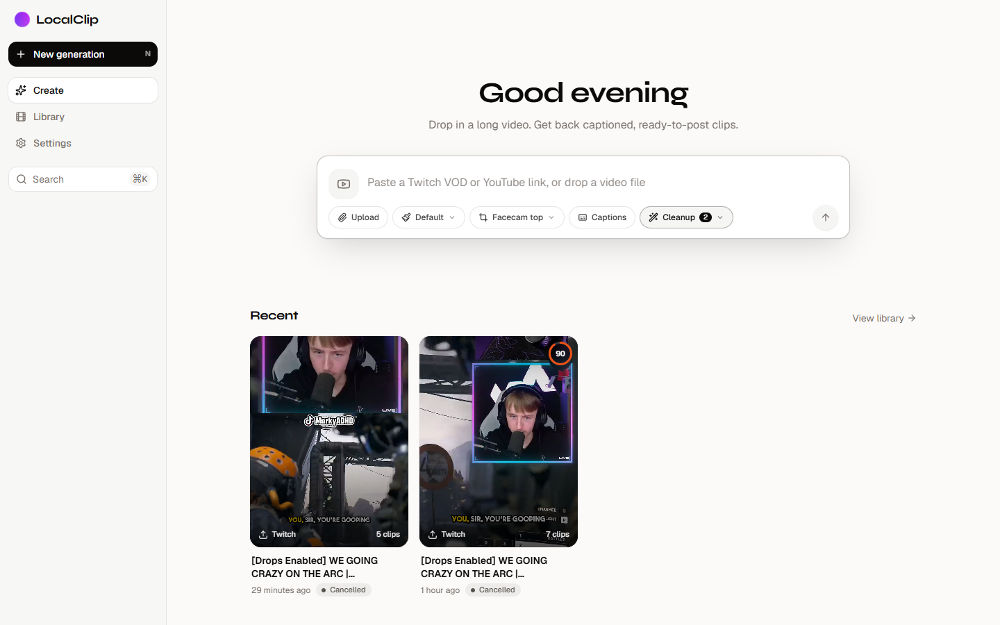
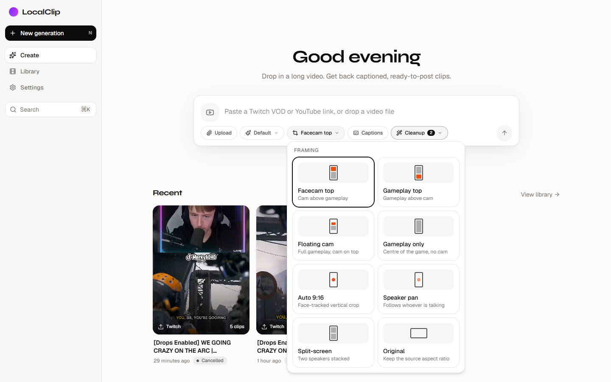
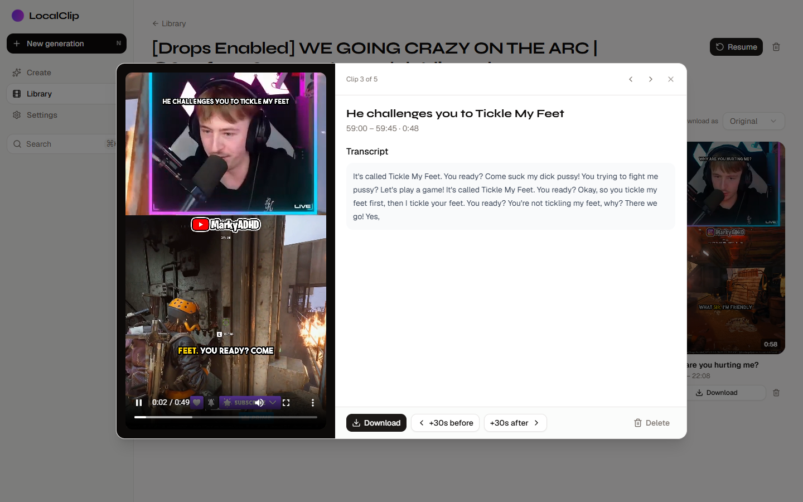
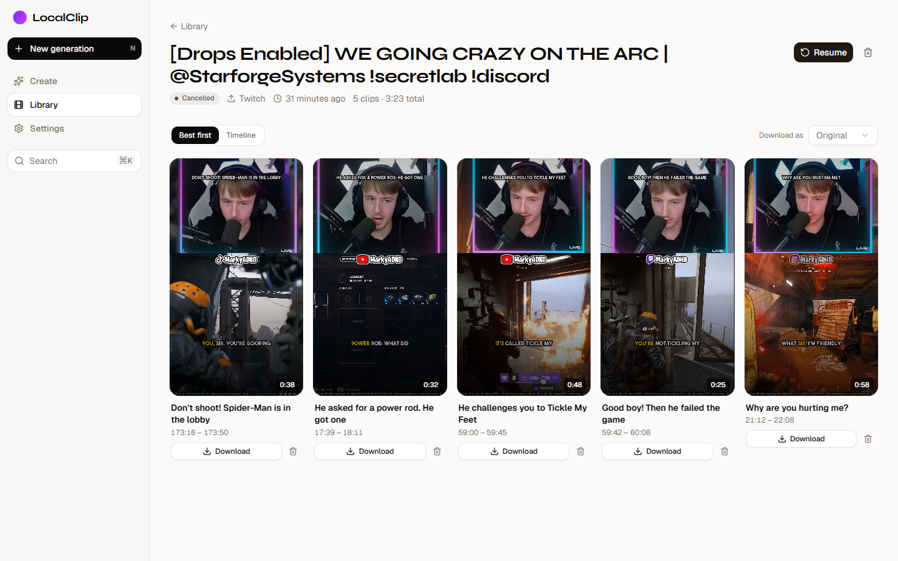

<p align="center">
  
</p>

<h1 align="center">LocalClip</h1>

<p align="center">
  <b>Bye Bye StreamLadder, Hello LocalClip.</b><br/>
  Turn your Twitch VODs into vertical TikTok / Shorts / Reels clips, on your own PC, for free.
</p>

<p align="center">
  <a href="../../releases/latest"></a>
  
  
  
</p>



Paste a Twitch VOD or a YouTube link. LocalClip downloads it, transcribes it on your GPU, reads your Twitch chat to find where it went off, and has **Claude Code** pick the best moments. Then it renders captioned 9:16 clips with your facecam stacked over your gameplay, just like the paid clipping tools do.

You don't need a subscription, you don't upload your VODs to someone else's server, and there are no watermarks or monthly clip limits. Everything runs on your machine.

## Why not StreamLadder?

| | StreamLadder | **LocalClip** |
|---|---|---|
| Price | Monthly subscription for the good stuff | **Free and open source** |
| Where it runs | Their servers | **Your PC** (your GPU does the work) |
| Finds the clips for you | You scrub the VOD yourself | **AI watches the whole VOD**, plus your chat |
| Facecam + gameplay layouts | ✅ | ✅ Facecam top, Gameplay top, Floating cam, Gameplay only |
| Animated captions | ✅ | ✅ Word-synced, several caption styles |
| Watermark / clip limits | On the free tier | **None** |
| Your VODs leave your PC | Yes | **No** (only the transcript text goes to Claude) |

## Features

- **Twitch VODs and YouTube links**, or upload any video file.
- **AI clip finding with Claude Code.** It reads the whole transcript and picks 15–60 second moments with a strong hook, scoring each one for virality.
- **Twitch chat signals.** LocalClip pulls the chat replay and finds the spikes where chat exploded (KEKW, LUL, Pog, "clip it"). Claude gets those as hints.
- **"Clip that" detection.** If you said "clip that" on stream, LocalClip notices and makes sure that moment is considered.
- **StreamLadder-style templates.** It auto-detects your webcam and builds the layout around it:
  - **Facecam top**: cam on top, gameplay below (the default)
  - **Gameplay top**: gameplay on top, cam below
  - **Floating cam**: the whole game frame on a blurred background, with your cam above it
  - **Gameplay only**: the centre of the game, no cam
  - Plus face-tracked crop, speaker pan, split-screen and original aspect for talking or podcast content
- **Word-synced captions** in several styles, with your own fonts and colours, plus an AI-written hook title for the first few seconds.
- **+30s before / +30s after.** Open a clip and extend it either way as many times as you like until the length is right. Each press re-renders the clip from the VOD.
- **Editor.** Trim, split, merge, edit captions and export presets for TikTok, Shorts and Reels.
- **One-click start and stop.** `LocalClip` starts everything, and `Close LocalClip` shuts all of it down (handy before you game).

<p align="center">
  
  
</p>



## Install (Windows 10/11)

**You need:**
- Windows 10 or 11 with [winget](https://learn.microsoft.com/windows/package-manager/winget/), which is built into Windows 11.
- A **Claude subscription** (Pro or Max). LocalClip runs Claude Code on your plan, so no API key is needed.
- An NVIDIA GPU is strongly recommended for fast transcription. It works on CPU, just slowly. 16 GB of RAM or more is recommended.
- Plenty of disk space. VODs are big.

**Option A:** download **`Install-LocalClip.cmd`** from the [latest release](../../releases/latest) and double-click it.

**Option B:** paste this into PowerShell:

```powershell
irm https://raw.githubusercontent.com/MarkyADHD/LocalClip/main/install.ps1 | iex
```

The installer:
1. Installs Git if it's missing and downloads LocalClip to `%LOCALAPPDATA%\LocalClip`.
2. Installs **Claude Code** if needed and asks you to sign in once with your Claude account.
3. Adds **LocalClip** and **Close LocalClip** shortcuts to your desktop and Start menu.
4. Starts LocalClip.

The first start takes a while because it downloads everything else: Python (via uv), Node, ffmpeg, PyTorch with CUDA, a portable PostgreSQL and Redis, and the Whisper model. After that it starts in seconds and opens **http://localhost:3107**. Every start also pulls the latest LocalClip update.

To stop everything, use **Close LocalClip**. Nothing keeps running in the background.

## How it works

```
 Twitch VOD / YouTube link / upload
                │
                ▼
   1. Download (yt-dlp + ffmpeg)            ── kept on your PC
                │
                ▼
   2. Transcribe with Whisper on your GPU   ── word-level timestamps
                │
                ▼
   3. Signals ─ Twitch chat spikes (chat replay, rolling median/MAD)
              ─ "clip that" moments in the transcript
                │
                ▼
   4. Claude Code picks the clips           ── transcript + signals → 15–60 s moments,
                │                               scores, hook titles (structured JSON)
                ▼
   5. Render each clip (ffmpeg)             ── facecam detection → template layout,
                │                               captions, hook title, 1080×1920 H.264
                ▼
   6. Your library at localhost:3107        ── preview, +30s, edit, export, download
```

### Claude Code is the brain

LocalClip doesn't need an OpenAI, Gemini or Anthropic API key. Instead, the backend runs the **Claude Code CLI** that's installed and signed in on your PC, in headless mode:

```
claude -p --model sonnet --output-format json --json-schema <clip schema> --tools "" --system-prompt <clip-picking rules>
```

- The transcript, with timestamps and the chat/"clip that" signals, goes to Claude on stdin.
- `--json-schema` makes Claude answer with structured clips: start, end, hook title, and hook, engagement, value and shareability scores.
- `--tools ""` means Claude can't run anything or touch your files. It only reads the text it's given and answers.
- It runs from an empty temp folder, so no project files shape the answer.
- Long VODs are analysed in overlapping 12-minute windows, three at a time. The candidates are then reranked together in one comparative Claude call, giving roughly one clip per 5 minutes of VOD, capped at 10 clips.

That's why it uses your **Claude plan** instead of per-token billing. Only the transcript text is sent to Claude. Your video never leaves your PC. The code lives in `backend/src/claude_code.py` and `backend/src/ai.py`.

> **v1 note:** in this first version of LocalClip, **only Claude Code is supported** for picking clips. **Support for local AI models** (Ollama and friends) is coming in a future release, so LocalClip will be able to run 100% offline.

### Finding your facecam

For the stream templates, LocalClip samples 16 frames across the clip and runs a face detector (YuNet, with a Haar cascade fallback). Your webcam is the face that **stays in the same spot** across those frames, while faces in the game move around. That box is padded to head and shoulders and cropped to the template's slot. A face that fills a big part of the frame is treated as a full-screen camera, which gets face-tracked framing instead. No face at all means the clip falls back to gameplay only. See `backend/src/media/stream_layouts.py`.

### Twitch chat as a signal

LocalClip downloads the VOD's chat replay from Twitch's public API. It counts messages and emote bursts per second, shifted back ~8 seconds because chat reacts after the moment. Then it flags the seconds well above the rolling 5-minute median. Those spikes go to Claude as hints like "Twitch chat exploded here." See `backend/src/twitch.py`.

### What runs on your PC

| Part | What it is |
|---|---|
| Web app | Next.js on `localhost:3107` |
| Backend API | FastAPI (Python) on `localhost:8000` |
| Worker | ARQ worker that runs the downloads, transcription, AI and rendering |
| Database | Portable PostgreSQL in `.localclip\postgres` |
| Queue | Portable Redis |
| Transcription | OpenAI Whisper (`turbo`) on CUDA |
| Clip picking | Claude Code CLI (`sonnet`) |
| Video | ffmpeg, OpenCV, YuNet face detection |

Everything lives inside the LocalClip folder (`.localclip\` holds the tools, database, videos and logs). The services are plain Windows processes, with no Docker and no WSL. `Close LocalClip` stops all of them.

## Settings

LocalClip creates a `.env` file on first start. Things you might want to change:

| Setting | Default | What it does |
|---|---|---|
| `LLM` | `claude-code:sonnet` | Claude model for picking clips (`claude-code:opus` works too) |
| `WHISPER_MODEL_SIZE` | `turbo` | `small` / `medium` for weaker GPUs, `large-v3` for best accuracy |
| `TRANSCRIPTION_LANGUAGE` | auto | Force a language, e.g. `en` or `es` |
| `MAX_CLIPS` | `10` | Most clips per VOD |
| `MAX_VIDEO_DURATION` | `43200` | Longest VOD in seconds (12 hours) |

## Troubleshooting

- **Logs** are in `%LOCALAPPDATA%\LocalClip\.localclip\logs`.
- **"Claude Code failed"** means you need to sign in again. Run `claude` in a terminal, sign in, then try again.
- **Slow transcription** means Whisper is probably on CPU. Make sure you have an NVIDIA GPU and up-to-date drivers.
- **Something stuck?** Run `Close LocalClip`, then `LocalClip` again.

## Roadmap

- Local AI models for clip picking (Ollama), for fully offline use
- More stream templates and draggable cam/gameplay regions
- Auto-posting to TikTok / YouTube Shorts

## License

[AGPL-3.0](LICENSE). See [NOTICE](NOTICE).
