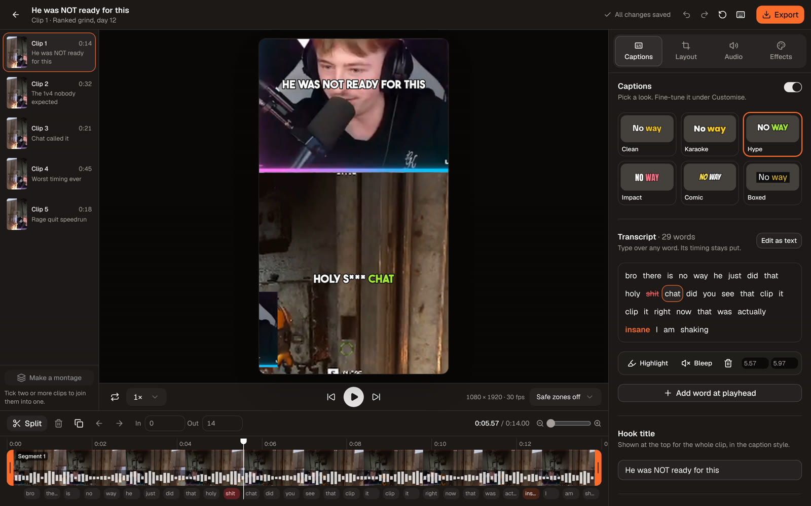

# Clip studio

Open **Edit** on a generated clip to enter `/tasks/[id]/edit?clip=<id>`.
The studio keeps generated clips intact. Its draft stores cuts, timed words,
caption styling, framing, audio gain, and video effects separately from the media.

## Editing

The studio is full screen: clips on the left, preview in the middle, tools on the
right, timeline along the bottom. Drafts autosave to the server and are also cached
locally for recovery after an interrupted save.

- **Timeline**: segments sit in playback order. Drag the orange ends of the selected
  segment to trim it, click or drag anywhere to scrub, and use Split, Remove,
  Duplicate and the arrows to cut and reorder. The row underneath shows every caption
  word where it is spoken. In/Out take exact seconds.
- **Layout**: 9:16, 1:1 or the original shape, then how the frame is filled. Fill and
  Fit crop one picture (Fit puts a blurred copy behind it). Cam top, Cam bottom and
  Floating cam cut the facecam out of the stream and place it with the gameplay, like
  the stream templates. The facecam is found when the clip is first opened; drag the
  blue box in the Layout tab to correct it. Drag the video in the preview to reframe.
- **Captions**: pick a look (Clean, Karaoke, Hype, Impact, Comic, Boxed) and fine-tune
  it under Customise: font, size, colours, outline, ALL CAPS, and lighting up the word
  being spoken. Drag the captions in the preview to move them.
- **Transcript**: type over any word. Clicking a word jumps to it and offers
  Highlight, Bleep, Delete and its timing. "Edit as text" rewrites whole phrases and
  keeps unchanged words anchored.
- **Hook title**: one line at the top for the whole clip, in the caption style.
- **Safe zones**: the menu under the preview shades what TikTok, Reels or Shorts cover
  with their own buttons (approximate; the apps move them).
- **Audio** controls exported gain, muting and swear bleeps. Playback speed changes
  preview only. **Effects** affect the video, not the captions.
- Undo/redo covers draft changes. **Restore original** resets the editing baseline
  and is itself undoable. Original generated files remain on the results page.
- Caption styles can be saved on the current device and applied to all task clips.
- Tick two or more clips and press **Make a montage** to join their cuts and words
  into a **new** clip, in the order ticked. The first clip supplies the style.
  Input clips stay intact.
- The export dialog shows the title and hashtags for the post; click to copy.

Shortcuts: Space plays/pauses; arrows step frames; Shift+arrows jump one second;
I/O set boundaries; S splits; Del removes the selected segment; Ctrl/Cmd+Z undoes;
Ctrl/Cmd+Shift+Z redoes; Ctrl/Cmd+S saves. Shortcuts are inactive in text fields and
dialogs.

## Export

The export dialog shows dimensions, edited duration, audio state, and approximate
file size. TikTok, Reels, and Shorts presets set target bitrates; the selected
framing controls the output aspect ratio.

**Background export** uses the worker and produces H.264/AAC MP4. Jobs keep running
when the editor closes and reappear in the export queue. Progress, cancellation,
failures, and completed downloads are available there. Export all clips queues
saved drafts sequentially, preparing uncached source media as needed.

**On this device** checks browser encoder support before starting. The canvas
renderer is shared by preview and browser export. AAC is preferred; browsers
without AAC encoding use Opus in MP4 and show a compatibility notice. Background
export is the most compatible choice. Keep the editor open for a browser export.

The server uses FFmpeg/libass, while browser export uses canvas/WebCodecs. Both
consume the same cut, word, style, layout, audio, and effects document, and caption
sizes are matched per font. Line wrapping, blur and color filtering can differ slightly
between rendering engines.

## Persistence and operation

No database migration or additional service is required. Deploy the frontend,
API, and worker together and restart the worker so it registers `prepare_editor`,
`export_editor`, and `combine_editor`.

The API and worker must share the existing `TEMP_DIR` volume. Editor files live
under `TEMP_DIR/editor/<hash-of-task-clip-and-source-version>/`:

- `clean.mp4`, thumbnails, and waveform metadata: prepared media cache.
- `original.json`: initial editing baseline.
- `draft.json`: current document and optimistic revision number.
- Export request snapshots, progress/status, cancellation markers, and MP4 outputs.

Back up this volume with generated clips. Removing it removes saved drafts and
exports. Undo history and saved caption presets are local to the browser; the
current draft is shared across devices. A changed original filename creates a new
editing baseline rather than applying old offsets to different media.

Preparation may redownload a YouTube source that generation cleanup removed.
Unavailable sources show a retryable error; the editor does not overlay a second
set of captions on an already captioned clip. Preparation and export require a
working ARQ worker and Redis connection.

## API

All routes require ownership of both the task and clip.

| Route suffix under `/tasks/{task}/clips/{clip}/editor` | Method | Purpose |
| --- | --- | --- |
| `/` (without trailing slash) | GET | Preparation state, original, draft, media metadata, recent exports |
| `/prepare` | POST | Queue source preparation |
| `/` (without trailing slash) | PATCH | Save `{basis, revision, document}`; stale writes return 409 |
| `/media/clean.mp4` | GET | Private preview with byte-range support |
| `/media/thumbnails.jpg` | GET | Timeline thumbnail strip |
| `/exports` | POST | Queue an immutable `{basis, preset, document}` snapshot |
| `/exports/{job}` | GET / DELETE | Poll / request cancellation |
| `/exports/{job}/file` | GET | Download a completed export |

`POST /tasks/{task}/editor/combine` takes ordered `clip_ids` and returns a background
job ID plus its anchor clip ID. Completion includes the new `clip_id`.

Legacy committed trim/split/merge/caption APIs remain available to API/MCP clients.
