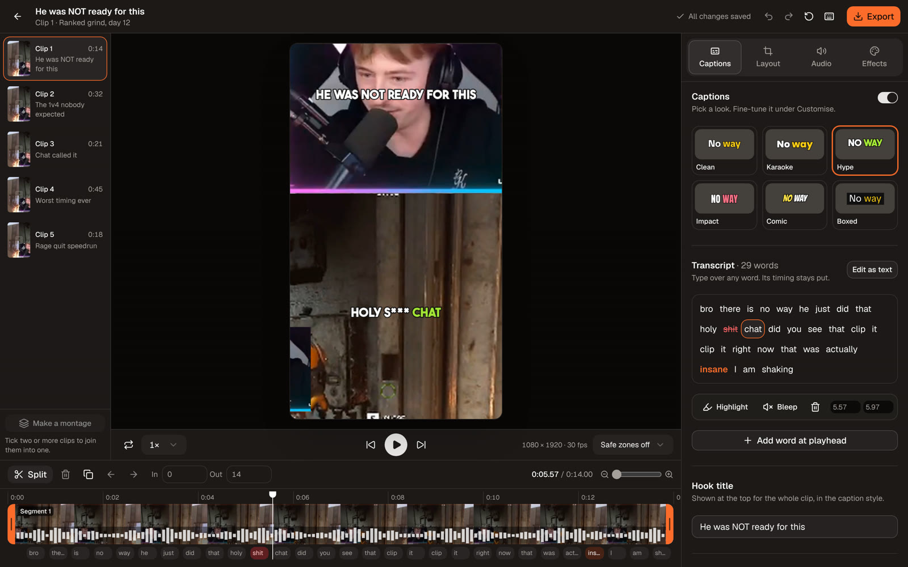

# Clip studio

Open **Edit** on a generated clip to enter `/tasks/[id]/edit?clip=<id>`.
The studio keeps generated clips intact. Its draft stores cuts, timed words,
caption styling, framing, audio gain, and video effects separately from the media.

## Editing

The studio is full screen: clips on the left, preview in the middle, tools on the
right, timeline along the bottom. Drafts autosave to the server and are also cached
locally for recovery after an interrupted save.

- **Timeline**: segments sit in playback order. Drag the orange ends of the selected
  segment to trim it, click or drag anywhere to scrub, and use Split, Remove,
  Duplicate and the arrows to cut and reorder. The row underneath shows every caption
  word where it is spoken: drag a word to move it, drag its ends to stretch it, hold
  Shift to move every later word too (`moveWord` in `document.ts`); arrow keys nudge a
  focused word by 0.05 s. In/Out take exact seconds.
- **Layout**: 9:16, 1:1 or the original shape, then how the frame is filled. Fill and
  Fit crop one picture (Fit puts a blurred copy behind it). Cam top, Cam bottom and
  Floating cam cut the facecam out of the stream and place it with the gameplay, like
  the stream templates. The facecam is found when the clip is first opened; drag the
  blue box in the Layout tab to correct it. Drag the video in the preview to reframe.
- **Captions**: pick a look (Clean, Karaoke, Hype, Impact, Comic, Boxed) and fine-tune
  it under Customise: font, size, colours, outline, ALL CAPS, and lighting up the word
  being spoken. Drag the captions in the preview to move them.
  **Entrance** brings each caption in with a pop, fade or slide (150 ms; `captionEntrance` in `render.ts` and
  `enter_tags` in `editor_document.py` must keep the same timing and sizes).
- **Speakers**: each clip's voices are told apart on your PC when the clip is made, and
  everyone after the main speaker gets their own caption colour. Pick each speaker's
  colour here. If a line went to the wrong person, click its first word in the transcript
  and press the numbered dot of the right speaker: it applies from that word until the
  speaker changes. `SPEAKER_CAPTIONS=false` turns detection off.
- **Transcript**: type over any word. Clicking a word jumps to it and offers
  Highlight, Bleep, Delete and its timing. "Edit as text" rewrites whole phrases and
  keeps unchanged words anchored. "Regenerate" runs Whisper on the clip again
  (`recaption_editor` in the worker) and replaces the words, with speakers detected again;
  the caption look stays. It asks first when the words differ from the original, and Undo
  brings them back.
- **Hook title**: one line at the top in the caption style, for a set number of seconds (`titleSeconds`, 0 = the whole clip).
- **Punch-in zoom** (`punches`, source times): a snap zoom of `PUNCH_ZOOM` towards the face or the
  facecam pane (`PUNCH_Y`), at the playhead or at the loudest moment. Preview and export use the same crop.
- **Slow motion** (`segments[].speed`, 0.25 to 1): the timeline's snail button slows a segment, the
  rewind button adds a half-speed replay of the last 2.5 s. Captions and punch-ins go through the same
  time mapping (`mapped`). The export fills in frames with ffmpeg's `minterpolate` (`SLOWMO_MODE`).
- **Export-only edits**: bleeps, slow motion, `cleanVoice` (ffmpeg denoise),
  `gameVolume` (voice split from game sound with Spleeter via sherpa-onnx, `media/stems.py`, stems
  cached beside the clip) and `framing.sharpCam` (Real-ESRGAN upscale of the facecam, `media/upscale.py`,
  downloaded on first use on Windows, `UPSCALE_MODEL`). None of these change the preview.
- **Safe zones**: the menu under the preview shades what TikTok, Reels or Shorts cover
  with their own buttons (approximate; the apps move them).
- **Audio** controls exported gain, muting and swear bleeps. Playback speed changes
  preview only. **Effects** affect the video, not the captions.
- Undo/redo covers draft changes. **Restore original** resets the editing baseline
  and is itself undoable. Original generated files remain on the results page.
- Caption styles can be saved on the current device and applied to all task clips.
- Tick two or more clips and press **Make a montage** to join their cuts and words
  into a **new** clip, in the order ticked. The first clip supplies the style.
  Input clips stay intact.
- The export dialog shows the title and hashtags for the post; click to copy.

Shortcuts: Space or K plays/pauses; arrows step frames; Shift+arrows jump one second;
J/L jump two seconds; Home/End go to the start/end; Ctrl+scroll zooms the timeline;
I/O set boundaries; S splits; Del removes the selected segment; Ctrl/Cmd+Z undoes;
Ctrl/Cmd+Shift+Z redoes; Ctrl/Cmd+S saves. Shortcuts are inactive in text fields and
dialogs.

## Export

The export dialog shows dimensions, edited duration, audio state, and approximate
file size. TikTok, Reels, and Shorts presets set target bitrates; the selected
framing controls the output aspect ratio.

Export always renders on the PC with the worker (FFmpeg/libass) and produces
H.264/AAC MP4. Jobs keep running when the editor closes and reappear in the export
queue. Progress, cancellation, failures, and completed downloads are available there.
Export all clips queues saved drafts sequentially, preparing uncached source media as needed.

The preview draws on a canvas, the export uses FFmpeg/libass. Both consume the same
cut, word, style, layout, audio, and effects document, and caption sizes are matched
per font. Line wrapping, blur and color filtering can differ slightly between them.

## Persistence and operation

No database migration or additional service is required. Deploy the frontend,
API, and worker together and restart the worker so it registers `prepare_editor`,
`export_editor`, and `combine_editor`.

The API and worker must share the existing `TEMP_DIR` volume. Editor files live
under `TEMP_DIR/editor/<hash-of-task-clip-and-source-version>/`:

- `clean.mp4`, thumbnails, and waveform metadata: prepared media cache.
- `original.json`: initial editing baseline.
- `draft.json`: current document and optimistic revision number.
- Export request snapshots, progress/status, cancellation markers, and MP4 outputs.

Back up this volume with generated clips. Removing it removes saved drafts and
exports. Undo history and saved caption presets are local to the browser; the
current draft is shared across devices. A changed original filename creates a new
editing baseline rather than applying old offsets to different media.

Preparation may redownload a YouTube source that generation cleanup removed.
Unavailable sources show a retryable error; the editor does not overlay a second
set of captions on an already captioned clip. Preparation and export require a
working ARQ worker and Redis connection.

## API

All routes require ownership of both the task and clip.

| Route suffix under `/tasks/{task}/clips/{clip}/editor` | Method | Purpose |
| --- | --- | --- |
| `/` (without trailing slash) | GET | Preparation state, original, draft, media metadata, recent exports |
| `/prepare` | POST | Queue source preparation |
| `/captions` | POST / GET | Queue a fresh transcription / poll it (`pending`, `ready` with `words`, `failed`) |
| `/` (without trailing slash) | PATCH | Save `{basis, revision, document}`; stale writes return 409 |
| `/media/clean.mp4` | GET | Private preview with byte-range support |
| `/media/thumbnails.jpg` | GET | Timeline thumbnail strip |
| `/exports` | POST | Queue an immutable `{basis, preset, document}` snapshot |
| `/exports/{job}` | GET / DELETE | Poll / request cancellation |
| `/exports/{job}/file` | GET | Download a completed export |

`POST /tasks/{task}/editor/combine` takes ordered `clip_ids` and returns a background
job ID plus its anchor clip ID. Completion includes the new `clip_id`.

Legacy committed trim/split/merge/caption APIs remain available to API/MCP clients.
